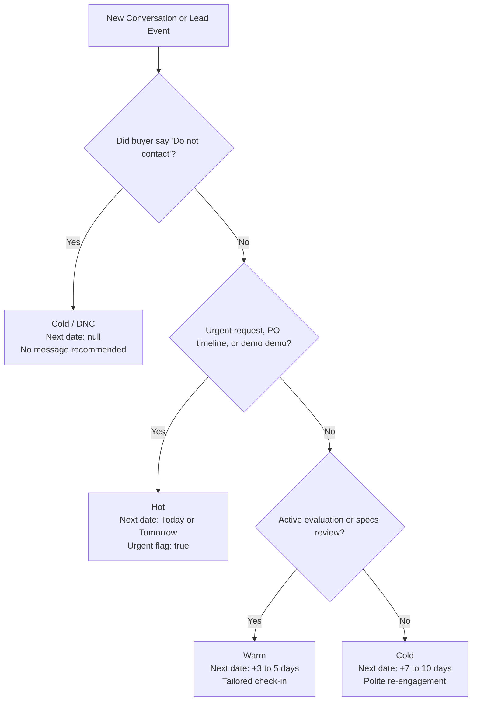

# gushpack

> **Intelligent AI-Powered Sales Lead Buddy & Follow-Up Assistant for B2B Packaging Machinery**

gushpack is a production-grade sales command center built for manufacturers and distributors of packaging equipment (VFFS machines, multihead weighers, pouch fillers, capping lines, shrink wrappers, and vacuum sealers). It bridges the gap between raw WhatsApp buyer conversations and fast sales execution by classifying deal intent, scheduling follow-up timing, and pre-drafting context-aware messages for sales reps.

---

## What We Built

- **Today's Command Workspace (`/`)**: A focused daily dashboard prioritizing overdue follow-ups, hot deals due today, and scheduled check-ins with one-tap actions (Call, Copy WhatsApp message, Mark as Sent, Open Details). Includes date simulation controls for testing pipelines over time.
- **Complete Leads Pipeline (`/leads`)**: Searchable and filterable pipeline database across all leads with status badges, source attribution (IndiaMART, Trade shows, Referrals, Inbound), and assigned sales reps with profile icons.
- **Lead Intelligence & WhatsApp History (`/leads/:id`)**: Comprehensive buyer profile with real-time AI classification breakdowns, deal urgency flags, rationale, next follow-up dates, and complete WhatsApp conversation history styled in authentic WhatsApp chat themes (light & dark).
- **Interactive Conversation Builder (`/leads/new`)**: Rapid intake for new prospects with live duplicate phone number detection, manual message bubble additions, or direct pasting of raw WhatsApp chat logs.
- **Gippi AI Sales Assistant**: A floating, animated AI copilot with full real-time database context across all 23 leads, sales reps, and WhatsApp chats. Responds naturally to greetings and answers detailed deal queries without generic or robotic templates.
- **Material 3 Borderless UI & Zero-Flicker Theming**: Clean borderless surfaces, custom floating mobile navigation dock, and anti-flicker dark/light mode toggle.

---

## How the Agent Decides Hot / Warm / Cold

The AI evaluation engine analyzes the full customer WhatsApp thread, lead metadata, and timeline using structured prompt instructions:



### 1. **Hot (High Intent & Immediate Attention)**
- **Criteria**:
  - Buyer is on a strict purchase deadline or festive season timeline (*"need to decide this week"*, *"line is down, need replacement immediately"*).
  - Explicit request for a commercial quotation (RFQ), machine trial/video demo, or purchase order (PO) finalization.
  - Buyer is actively comparing shortlisted vendors and waiting on pricing/specifications.
- **Scheduling**: Follow-up is set for **today** (or tomorrow if the rep already replied today).
- **Flag**: `urgent = true`.
- **Action**: Generates a high-priority outreach message to close the commitment.

### 2. **Warm (Interested & Evaluating)**
- **Criteria**:
  - Buyer requests technical specifications or customization details (e.g. nitrogen flushing capability, pouch dimensions, output per minute).
  - Buyer is reviewing proposals internally with their team (*"discussing with partner"*, *"reviewing with production head"*).
  - Buyer has an active project but an extended timeline (*"director traveling for 2 weeks"*, *"budget planned for next quarter"*).
- **Scheduling**: Follow-up is set for **3 to 5 days** out, or mapped precisely to the buyer's explicit callback date.
- **Flag**: `urgent = false`.
- **Action**: Drafts a supportive, value-adding check-in addressing technical inquiries.

### 3. **Cold (Low Intent or Inactive)**
- **Criteria**:
  - Buyer explicitly states they bought elsewhere or asks not to be contacted (*"bought from another vendor, please don't contact"*).
  - Multiple follow-ups sent with zero response from the buyer.
  - Early exploratory enquiries with no budget, timeline, or defined machine requirement.
- **Scheduling**: Follow-up set **7 to 14 days** out, or `null` if marked Do Not Contact (`do_not_contact = true`).
- **Action**: Either drafts a polite, non-pushy check-in or flags the lead as inactive to save sales rep time.

---

## AI Tools & Architecture

```
┌─────────────────────────────────────────────────────────────────┐
│                       Gippi AI Assistant                        │
├─────────────────────────────────────────────────────────────────┤
│                     Vercel AI SDK (Core Engine)                 │
│                                │                                │
│       ┌────────────────────────┴────────────────────────┐       │
│       ▼                                                 ▼       │
│  Primary Model                                  Fallback Chain  │
│  Google Gemini 3.8 Flash                   ┌──────────────────┐ │
│  (Google AI Studio)                        │ gemini-3.6-flash │ │
│                                            ├──────────────────┤ │
│                                            │ gemini-3.5-flash │ │
│                                            ├──────────────────┤ │
│                                            │ OpenAI gpt-4o    │ │
│                                            └──────────────────┘ │
└─────────────────────────────────────────────────────────────────┘
                                │
               Real-time PostgreSQL Data Grounding
      (Leads, Messages, Sales Reps, Pipeline Analytics)
```

1. **Vercel AI SDK (`ai`, `@ai-sdk/google`, `@ai-sdk/openai`)**:
   Unified LLM interface for structured JSON generation, streaming, and model failovers.
2. **Google Gemini 3.8 Flash (`gemini-3.8-flash`)**:
   Selected as the primary reasoning model for fast inference, complex B2B conversation comprehension, and large context windows.
3. **Resilient Multi-Model Fallback Chain**:
   To prevent free-tier rate limits (`429`) from disrupting the sales workflow, the engine automatically cascades requests:
   `gemini-3.8-flash` ➔ `gemini-3.6-flash` ➔ `gemini-3.5-flash` ➔ `gpt-4o-mini`.
4. **Structured In-Memory Context Injection**:
   Every question posed to the Gippi Bot dynamically pulls live PostgreSQL rows (all 23 leads, recent buyer/rep conversation snippets, assigned sales reps, and urgency states) directly into the system prompt for accurate, hallucination-free answers.
5. **Deterministic Heuristic Fallback (`analyzeFallback`)**:
   Offline rule engine that guarantees lead classification and follow-up generation even if external AI APIs are disconnected.

---

## Tech Stack

- **Framework**: TanStack Start (SSR + Vite 8)
- **Routing**: TanStack Router (File-based, fully type-safe)
- **State & Data Fetching**: TanStack Query (React Query)
- **Database & Storage**: Supabase (PostgreSQL with Row Level Security)
- **Styling**: Tailwind CSS v4 + Radix UI Primitives
- **Icons**: Lucide React
- **Testing**: Vitest + React Testing Library (13/13 passing tests)

---

## What We Would Build Next (Roadmap)

1. **Direct Meta WhatsApp Cloud API Integration**:
   - Webhook-based two-way sync to automatically capture inbound buyer messages into the database in real time, eliminating manual chat log pasting.
2. **Multilingual Voice Note Transcription**:
   - Integration with Whisper / Gemini Multimodal audio to transcribe and analyze voice messages from Indian B2B buyers speaking Hindi, Hinglish, and regional languages.
3. **Automated Quotation & Spec Sheet PDF Generator**:
   - One-click generation of branded PDF machinery quotations and technical spec sheets attached directly to drafted follow-ups.
4. **Multi-Tenant Auth & Role-Based Access Control (RBAC)**:
   - Supabase Auth roles: Sales managers can view team-wide metrics and reassign accounts; sales reps see only their assigned accounts.
5. **Automated Follow-Up Broadcast Sequences**:
   - Drip follow-up cadences with approval gates (e.g., Day 1: Brochure ➔ Day 3: Video Demo ➔ Day 7: Case Study).
6. **Deal Win-Rate & Source Attribution Analytics**:
   - Performance dashboards highlighting revenue velocity by lead source (Trade shows vs IndiaMART vs Cold Outreach) and rep closing rates.

---

## Setup & Local Development

### 1. Clone & Install Dependencies
```bash
git clone <your-repo-url>
cd ai-lead-buddy
npm install
```

### 2. Configure Environment Variables
Copy `.env.example` to `.env`:
```bash
cp .env.example .env
```
Fill in your credentials:
```env
SUPABASE_PROJECT_ID="your-project-id"
SUPABASE_PUBLISHABLE_KEY="your-supabase-key"
SUPABASE_URL="https://your-project-id.supabase.co"

GEMINI_API_KEY="your-google-ai-studio-gemini-key"
GEMINI_MODEL="gemini-3.8-flash"
```

### 3. Run Development Server
```bash
npm run dev
```
Open [http://localhost:8080](http://localhost:8080) in your browser.

### 4. Run Tests & Build
```bash
npm test         # Run Vitest test suite
npm run build:dev # Validate full production bundle compilation
```
